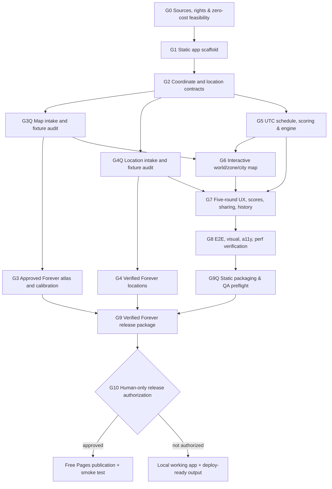

# Dependency graph, ownership, test gates

The graph is a *dependency graph*, not permission to run conflicting implementation agents simultaneously. Validate a node's gate before downstream nodes start. When upstream code changes, mark relevant downstream gates stale and rerun.



| Node | Suggested owner and edit boundary | Gate that unlocks next node |
| --- | --- | --- |
| G0 | Lead; `docs/research`, `DATA_PROVENANCE.md` | Evidence-based map and coordinates feasibility report; third-party rights inventoried, no unsupported scraping plan |
| G1 | Lead; package config, `src/main*`, CI | Fresh install, lint, typecheck, build, `npm run dev` starts |
| G2 | Lead; `src/domain/`, `tests/fixtures/` | Zod validation + known geographic fixture transforms and round-trip tests |
| G3Q | Cartography subagent; `scripts/maps/`, `tests/fixtures/maps/` | The isolated QA atlas loads and passes the technical audit |
| G3 | Cartography; `public/maps/` | Real Forever maps load, meet limits and pass coverage, calibration, label and rights review |
| G4Q | Data subagent; `scripts/data/`, `data/` | The intake pipeline passes validation tests |
| G4 | Data; `public/game/locations.json` | Verified-source metadata, zero invalid coordinates or duplicates and real coverage/count report |
| G5 | Engine subagent; `src/engine/`, `src/scoring/`, `src/schedule/`, `tests/unit/engine/` | UTC deterministic puzzle, freeze-history, scoring correctness and precision tests |
| G6 | Map UI; `src/components/map/`, `src/maps/renderer/` | Playwright zoom/pan/city enter/back/pin; desktop + mobile screenshots |
| G7 | Game UI; `src/components/game/`, `src/storage/`, `src/share/` | Automated full 5 rounds, restart midgame, result, share, streak/local storage scenarios |
| G8 | QA; `tests/e2e/`, `docs/QA_REPORT.md` | Full test matrix, browser console and asset errors cleared; a11y & performance reported |
| G9Q | Lead; `dist/`, `public/_headers`, `docs/DEPLOY.md` | Count files, max bytes, static requests, clean-build preview and smoke tests |
| G9 | Lead; `dist/`, `public/game/` | Real atlas and data pass audit. Frozen schedule and hashed assets pass preflight. |
| G10 | Human only | Approve asset release rights and grant explicit Cloudflare connection/publish action; otherwise stop without publishing |

**Graph status contract:**

```json
{
  "nodes": {
    "G0": {"status":"pending","attempts":0,"owner":"lead","dependencies":[],"gate":"Source and hosting review","evidence":[],"blocker":null}
  },
  "lastUpdated":"ISO8601 timestamp",
  "releaseState":"NOT_READY"
}
```

Only one owner should edit an owned directory during a phase; QA can read other subtrees. Freeze shared TypeScript interfaces after G2; contract modifications require coordination, rebasing and retesting. If 3 repairs fail, escalate to alternate implementation or precise BLOCKED node; never quietly move forward with an unsupported PASS.

## Short test checklist per dependency edge

1. G1 -> G2: clean install/typecheck/lint/build.
2. G2 -> G3Q,G4Q,G5: map transform round-trip and answer schema validators.
3. G3Q -> G6 and G3: fixture maps load and pass the technical audit.
4. G4Q -> G7 and G4: intake checks cover source quality, geometry and deduplication.
5. G5 -> G6,G7: fixed daily schedule and deterministic scores; runtime has no network AI.
6. G6 -> G7: mobile + desktop zoom/pin/city navigation input tests.
7. G7 -> G8: 5 complete rounds, reload persistence and share tests.
8. G8 -> G9Q: browser, accessibility and responsive regression report.
9. G3,G4,G9Q -> G9 -> G10: authorized real content, a frozen schedule, free-tier preflight and a production preview.
10. G10 -> live: approval and verified deployed URL or precise instructions if no credentials.

## Software verification when source content is unavailable

G3 and G4 each track implementation evidence and real-content evidence. A missing atlas or insufficient verified locations blocks their real-content gates. Passing fixture-only renderer, validation and content-loading checks can unlock the G6/G7 software work through a local QA server. Production readiness, the real map visual audit, release dataset verification and publication still require the real G3/G4 gates to pass. Fixture assets and entries stay under tests and outside the default production bundle.
